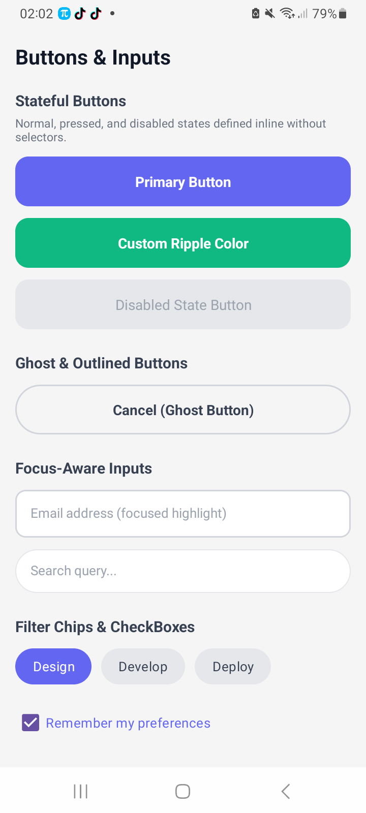
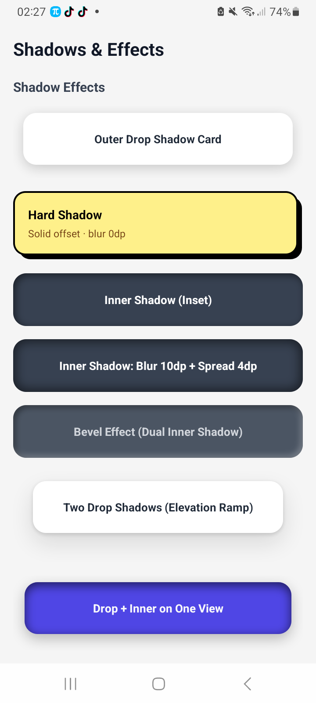
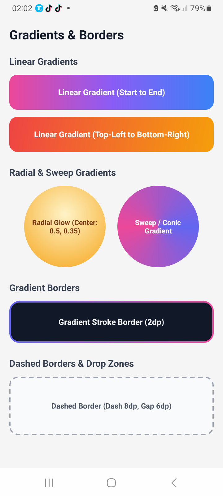
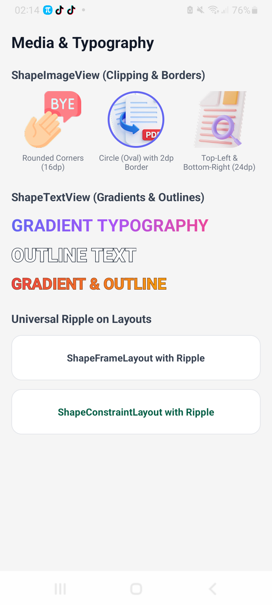
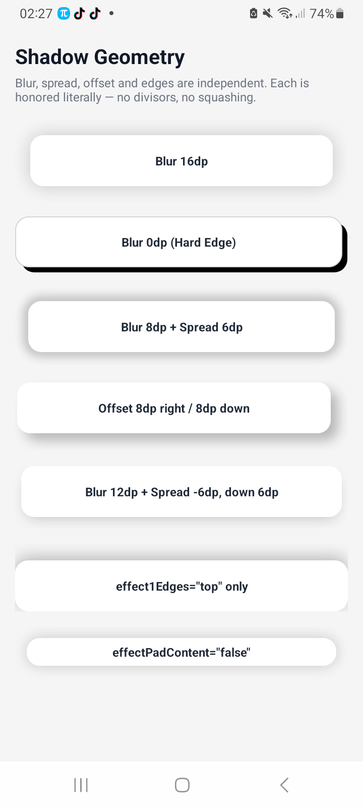

# ShapeView-ktx

[](https://jitpack.io/#impeterwayne/ShapeView)
[](https://android-arsenal.com/api?level=23)
[](https://opensource.org/licenses/Apache-2.0)

**Stop writing boilerplate `res/drawable` XML files.**  
ShapeView lets you design backgrounds, rounded corners, state selectors, gradients, ripples, and Figma-style drop & inner shadows directly in your layout XML or dynamically at runtime with Kotlin builders.

<table align="center">
  <tr>
    <th align="center">Buttons, Inputs & States</th>
    <th align="center">Figma Drop & Inner Shadows</th>
  </tr>
  <tr>
    <td align="center"></td>
    <td align="center"></td>
  </tr>
  <tr>
    <th align="center">Gradients & Borders</th>
    <th align="center">Media & Typography</th>
  </tr>
  <tr>
    <td align="center"></td>
    <td align="center"></td>
  </tr>
  <tr>
    <th align="center" colspan="2">Shadow Geometry Controls</th>
  </tr>
  <tr>
    <td align="center" colspan="2"></td>
  </tr>
</table>

```
Traditional Android (3 files):                   ShapeView (Inline in XML):
├── res/drawable/btn_normal.xml                  <com.genesys.shape.view.ShapeButton
├── res/drawable/btn_pressed.xml          👉         app:shape_radius="12dp"
└── res/drawable/btn_selector.xml                    app:shape_solidColor="#6366F1"
                                                     app:shape_solidPressedColor="#4F46E5" />
```

---

## Table of Contents

- [Installation](#installation)
- [Quick Start](#quick-start)
- [Attribute Reference](#attribute-reference)
- [Recipe Gallery](#recipe-gallery)
  - [Buttons, Inputs & States](#1-buttons-inputs--states)
  - [Cards, Sheets & Shadows](#2-cards-sheets--shadows)
  - [Gradients & Borders](#3-gradients--borders)
  - [Media & Typography](#4-media--typography)
- [Changing Shapes at Runtime](#changing-shapes-at-runtime)
- [Figma-Style Effects Engine](#figma-style-effects-engine)
- [Requirements](#requirements)
- [License](#license)

---

## Installation

### 1. Add JitPack repository

Add JitPack to your `settings.gradle` or `settings.gradle.kts`:

<details open>
<summary><b>Groovy (settings.gradle)</b></summary>

```groovy
dependencyResolutionManagement {
    repositories {
        google()
        maven { url 'https://jitpack.io' }
    }
}
```
</details>

<details>
<summary><b>Kotlin DSL (settings.gradle.kts)</b></summary>

```kotlin
dependencyResolutionManagement {
    repositories {
        google()
        maven { url = uri("https://jitpack.io") }
    }
}
```
</details>

### 2. Add dependency

Add the library to your app module `build.gradle` or `build.gradle.kts`:

<details open>
<summary><b>Groovy (build.gradle)</b></summary>

```groovy
dependencies {
    implementation 'com.github.impeterwayne:ShapeView:1.0.2'
}
```
</details>

<details>
<summary><b>Kotlin DSL (build.gradle.kts)</b></summary>

```kotlin
dependencies {
    implementation("com.github.impeterwayne:ShapeView:1.0.2")
}
```
</details>

---

## Quick Start

### The 3-Rule Mental Model

Ninety percent of styling follows three intuitive attribute prefixes:

| Prefix | What it styles | Example |
|---|---|---|
| `shape_solid*` | The view's background fill | `shape_solidColor` |
| `shape_stroke*` | The border / outline | `shape_strokeSize`, `shape_strokeColor` |
| `shape_text*` | Text color / outline *(Text views only)* | `shape_textColor`, `shape_textPressedColor` |

Any of these can take a **state suffix** (`Pressed`, `Checked`, `Disabled`, `Focused`, `Selected`) or **gradient colors** instead of a flat color.

### Drop-in Replacement

Swap any standard platform view for its `Shape*` counterpart. Nothing else changes — `ShapeButton` is a `Button`, `ShapeLinearLayout` is a `LinearLayout`. All existing attributes, click listeners, and view bindings keep working seamlessly:

```xml
<com.genesys.shape.view.ShapeButton
    android:layout_width="match_parent"
    android:layout_height="52dp"
    android:text="Continue"
    android:textColor="#FFFFFF"
    app:shape_radius="12dp"
    app:shape_solidColor="#6366F1"
    app:shape_solidPressedColor="#4F46E5"
    app:shape_solidDisabledColor="#C7D2FE" />
```

---

## Attribute Reference

<details open>
<summary><b>1. Base Shape & Dimensions</b></summary>

| Attribute | Format | Default | Description |
|---|---|---|---|
| `shape_type` | enum | `rectangle` | `rectangle` · `oval` · `line` · `ring` |
| `shape_width` | dimension | view width | Explicit shape width |
| `shape_height` | dimension | view height | Explicit shape height |
</details>

<details open>
<summary><b>2. Corner Radii (RTL-Ready)</b></summary>

| Attribute | Format | Description |
|---|---|---|
| `shape_radius` | dimension | Uniform radius on all 4 corners |
| `shape_radiusInTopStart` / `…TopLeft` | dimension | Top start (auto-flips in RTL) / Top left |
| `shape_radiusInTopEnd` / `…TopRight` | dimension | Top end (auto-flips in RTL) / Top right |
| `shape_radiusInBottomStart` / `…BottomLeft` | dimension | Bottom start (auto-flips in RTL) / Bottom left |
| `shape_radiusInBottomEnd` / `…BottomRight` | dimension | Bottom end (auto-flips in RTL) / Bottom right |

> Individual corner attributes override `shape_radius`.
</details>

<details open>
<summary><b>3. Background Fill & State Colors</b></summary>

| Attribute | Format | Notes |
|---|---|---|
| `shape_solidColor` | color | Default background fill |
| `shape_solidPressedColor` | color | Pressed state |
| `shape_solidDisabledColor` | color | Disabled state |
| `shape_solidFocusedColor` | color | Focused state |
| `shape_solidSelectedColor` | color | Selected state |
| `shape_solidCheckedColor` | color | Checked state (`ShapeCheckBox` / `ShapeRadioButton` only) |
</details>

<details>
<summary><b>4. Fill Gradients</b></summary>

Set `StartColor` and `EndColor` to activate a gradient fill (replaces `shape_solidColor`).

| Attribute | Format | Default | Description |
|---|---|---|---|
| `shape_solidGradientStartColor` | color | | Start color |
| `shape_solidGradientCenterColor` | color | | Center color (optional) |
| `shape_solidGradientEndColor` | color | | End color |
| `shape_solidGradientOrientation` | enum | `startToEnd` | `startToEnd` · `endToStart` · `topToBottom` · `bottomToTop` · `topLeftToBottomRight` · etc. |
| `shape_solidGradientCenterX` · `…CenterY` | float | `0.5` | Center point (0.0 to 1.0) for radial/sweep |
| `shape_solidGradientRadiusSize` | dimension | | Absolute radial radius |
| `shape_solidGradientRadiusRatio` | float | `0.5` | Radial radius as ratio of half shortest side |
| `shape_solidGradientRadiusX` · `…RadiusY` | float | `-1` | Elliptical scale factors |
| `shape_solidRadialAngle` | float | `0` | Radial rotation in degrees |
| `shape_solidGradientStartPercent` | float | `0.0` | Color stop position for start color |
| `shape_solidGradientCenterPercent` | float | `0.5` | Color stop position for center color |
| `shape_solidGradientEndPercent` | float | `1.0` | Color stop position for end color |
| `shape_solidGradientStartX` · `…StartY` | float | | Explicit linear start point (0.0–1.0) |
| `shape_solidGradientEndX` · `…EndY` | float | | Explicit linear end point (0.0–1.0) |

> [!WARNING]
> `shape_solidGradientRadius` is **deprecated** in favor of `shape_solidGradientRadiusSize` and `shape_solidGradientRadiusRatio`.
</details>

<details open>
<summary><b>5. Stroke (Border) & Dashes</b></summary>

| Attribute | Format | Notes |
|---|---|---|
| `shape_strokeSize` | dimension | Border thickness (required for stroke to draw) |
| `shape_strokeColor` | color | Default border color |
| `shape_strokePressedColor` | color | Pressed border color |
| `shape_strokeDisabledColor` | color | Disabled border color |
| `shape_strokeFocusedColor` | color | Focused border color |
| `shape_strokeSelectedColor` | color | Selected border color |
| `shape_strokeCheckedColor` | color | Checked border color (`ShapeCheckBox` / `ShapeRadioButton`) |
| `shape_strokeDashSize` | dimension | Dash length (`0` = solid line) |
| `shape_strokeDashGap` | dimension | Gap between dashes |
</details>

<details>
<summary><b>6. Stroke Gradients</b></summary>

Stroke gradients share the exact same configuration as fill gradients by substituting the `solid` prefix with `stroke`:  
`shape_strokeGradientStartColor` · `…CenterColor` · `…EndColor` · `…Type` · `…Orientation` · `…CenterX/Y` · `…RadiusSize` · `…RadiusRatio` · `…RadiusX/Y` · `shape_strokeRadialAngle` · `…StartPercent` · `…CenterPercent` · `…EndPercent` · `…StartX/Y` · `…EndX/Y`.
</details>

<details>
<summary><b>7. Rings & Lines</b></summary>

#### Ring (`shape_type="ring"`)
| Attribute | Format | Default | Description |
|---|---|---|---|
| `shape_ringInnerRadiusSize` | dimension | `-1` | Inner radius, absolute |
| `shape_ringInnerRadiusRatio` | float | `3.0` | Inner radius = ring size ÷ ratio |
| `shape_ringThicknessSize` | dimension | `-1` | Ring thickness, absolute |
| `shape_ringThicknessRatio` | float | `9.0` | Thickness = ring size ÷ ratio |

#### Line (`shape_type="line"`)
| Attribute | Format | Default | Description |
|---|---|---|---|
| `shape_lineGravity` | flags | `center` | `top` · `bottom` · `left` · `right` · `start` · `end` · `center` |
</details>

<details>
<summary><b>8. Typography & Text Outlines (Text Views Only)</b></summary>

| Attribute | Format | Description |
|---|---|---|
| `shape_textColor` | color | Default text color |
| `shape_textPressedColor` | color | Pressed text color |
| `shape_textDisabledColor` | color | Disabled text color |
| `shape_textFocusedColor` | color | Focused text color |
| `shape_textSelectedColor` | color | Selected text color |
| `shape_textCheckedColor` | color | Checked text color (`ShapeCheckBox` / `ShapeRadioButton`) |
| `shape_textStartColor` | color | Gradient start color |
| `shape_textCenterColor` | color | Gradient center color (optional) |
| `shape_textEndColor` | color | Gradient end color |
| `shape_textGradientOrientation` | enum | `horizontal` (default) · `vertical` |
| `shape_textStrokeColor` | color | Text outline color |
| `shape_textStrokeSize` | dimension | Text outline thickness |
</details>

<details>
<summary><b>9. Ripple & Button Drawables</b></summary>

#### Ripple Effect
| Attribute | Format | Default | Description |
|---|---|---|---|
| `shape_ripple_enabled` | boolean | `false` | Enables ripple **and automatically sets view clickable** |
| `shape_ripple_color` | color | `#20FFFFFF` | Ripple color |
| `shape_ripple_radius` | dimension | corner radii | Overrides default ripple mask radius |

#### Button State Drawables (`ShapeCheckBox` / `ShapeRadioButton`)
`shape_buttonDrawable` · `shape_buttonPressedDrawable` · `shape_buttonCheckedDrawable` · `shape_buttonDisabledDrawable` · `shape_buttonFocusedDrawable` · `shape_buttonSelectedDrawable` (all accept `@drawable/…` references).
</details>

---

## Recipe Gallery

### 1. Buttons, Inputs & States

<p align="center">
  
</p>

#### Button with Interactive States
No selector drawables required. Define normal, pressed, and disabled colors directly in XML:

```xml
<com.genesys.shape.view.ShapeButton
    android:layout_width="match_parent"
    android:layout_height="52dp"
    android:text="Submit"
    app:shape_radius="26dp"
    app:shape_solidColor="#6366F1"
    app:shape_solidPressedColor="#4F46E5"
    app:shape_solidDisabledColor="#E5E7EB"
    app:shape_textColor="#FFFFFF"
    app:shape_textDisabledColor="#9CA3AF" />
```

#### Ghost (Outlined) Button
Transparent fill with a crisp 1dp border that highlights on press:

```xml
<com.genesys.shape.view.ShapeButton
    android:layout_width="match_parent"
    android:layout_height="52dp"
    android:text="Cancel"
    app:shape_radius="26dp"
    app:shape_solidColor="#00000000"
    app:shape_strokeSize="1dp"
    app:shape_strokeColor="#D1D5DB"
    app:shape_strokePressedColor="#6366F1" />
```

#### Input Field with Focus Highlight
Border and fill shift smoothly when the user focuses the input field:

```xml
<com.genesys.shape.view.ShapeEditText
    android:layout_width="match_parent"
    android:layout_height="48dp"
    android:hint="Email address"
    android:paddingHorizontal="16dp"
    app:shape_radius="8dp"
    app:shape_solidColor="#FFFFFF"
    app:shape_strokeSize="1dp"
    app:shape_strokeColor="#D1D5DB"
    app:shape_strokeFocusedColor="#6366F1"
    app:shape_solidFocusedColor="#F5F3FF" />
```

#### Selectable Chip / Pill (`ShapeCheckBox`)
Use `ShapeCheckBox` or `ShapeRadioButton` with `Checked` attributes for zero-code filter chips:

```xml
<com.genesys.shape.view.ShapeCheckBox
    android:layout_width="wrap_content"
    android:layout_height="36dp"
    android:button="@null"
    android:gravity="center"
    android:paddingHorizontal="16dp"
    android:text="Design"
    app:shape_radius="18dp"
    app:shape_solidColor="#F3F4F6"
    app:shape_solidCheckedColor="#6366F1"
    app:shape_textColor="#374151"
    app:shape_textCheckedColor="#FFFFFF" />
```

> [!TIP]
> `ShapeCheckBox` and `ShapeRadioButton` also support custom state icons via `app:shape_buttonDrawable`, `app:shape_buttonCheckedDrawable`, and `app:shape_buttonDisabledDrawable`.

---

### 2. Cards, Sheets & Shadows

<p align="center">
  
</p>

#### Card with Soft Drop Shadow
Figma-accurate box shadow with custom blur and vertical offset:

```xml
<com.genesys.shape.layout.ShapeLinearLayout
    android:layout_width="match_parent"
    android:layout_height="wrap_content"
    android:orientation="vertical"
    android:padding="16dp"
    app:shape_radius="16dp"
    app:shape_solidColor="#FFFFFF"
    app:shape_effect1Color="#30000000"
    app:shape_effect1Blur="12dp"
    app:shape_effect1OffsetY="4dp" />
```

#### Neo-Brutalist Card (100% Solid Hard Shadow)
Setting `blur="0dp"` disables Gaussian blurring, rendering a crisp, 100% solid vector silhouette offset behind the shape with a bold border:

```xml
<com.genesys.shape.layout.ShapeLinearLayout
    android:layout_width="match_parent"
    android:layout_height="wrap_content"
    android:orientation="vertical"
    android:padding="18dp"
    app:shape_radius="14dp"
    app:shape_solidColor="#FEF08A"
    app:shape_strokeColor="#000000"
    app:shape_strokeSize="2dp"
    app:shape_effect1Blur="0dp"
    app:shape_effect1Color="#FF000000"
    app:shape_effect1OffsetX="6dp"
    app:shape_effect1OffsetY="6dp"
    app:shape_ripple_enabled="true"
    app:shape_ripple_color="#26000000" />
```

#### Bottom Sheet (Top Shadow Only)
By default, shadows cast room on all sides. Use `shape_effect1Edges="top"` to only reserve space on top, leaving the bottom, left, and right flush with the screen edges:

```xml
<com.genesys.shape.layout.ShapeLinearLayout
    android:layout_width="match_parent"
    android:layout_height="wrap_content"
    android:orientation="vertical"
    app:shape_radiusInTopLeft="24dp"
    app:shape_radiusInTopRight="24dp"
    app:shape_solidColor="#FFFFFF"
    app:shape_effect1Color="#59000000"
    app:shape_effect1Blur="20dp"
    app:shape_effect1OffsetY="-6dp"
    app:shape_effect1Edges="top" />
```

#### Elevation Ramp (Two Layered Drop Shadows)
A tight contact shadow layered with a wide ambient shadow for high-end elevation:

```xml
<com.genesys.shape.layout.ShapeLinearLayout
    android:layout_width="match_parent"
    android:layout_height="wrap_content"
    android:padding="16dp"
    app:shape_radius="16dp"
    app:shape_solidColor="#FFFFFF"
    app:shape_effect1Color="#26000000"
    app:shape_effect1Blur="4dp"
    app:shape_effect1OffsetY="2dp"
    app:shape_effect2Color="#1F000000"
    app:shape_effect2Blur="24dp"
    app:shape_effect2OffsetY="12dp" />
```

#### Neumorphic Bevel (Two Inner Shadows)
Layering a dark inner shadow and a light highlight creates an embossed / pressed effect:

```xml
<com.genesys.shape.layout.ShapeConstraintLayout
    android:layout_width="200dp"
    android:layout_height="200dp"
    app:shape_radius="24dp"
    app:shape_solidColor="#E0E5EC"
    app:shape_effect1Type="innerShadow"
    app:shape_effect1Color="#40000000"
    app:shape_effect1Blur="6dp"
    app:shape_effect1OffsetX="4dp"
    app:shape_effect1OffsetY="4dp"
    app:shape_effect2Type="innerShadow"
    app:shape_effect2Color="#80FFFFFF"
    app:shape_effect2Blur="6dp"
    app:shape_effect2OffsetX="-4dp"
    app:shape_effect2OffsetY="-4dp" />
```

---

### 3. Gradients & Borders

<p align="center">
  
</p>

#### Linear, Radial & Sweep Gradients
Set `StartColor` and `EndColor` (center color is optional). Choose linear, radial, or conic sweep:

```xml
<!-- Linear Gradient -->
<com.genesys.shape.view.ShapeView
    android:layout_width="match_parent"
    android:layout_height="120dp"
    app:shape_radius="16dp"
    app:shape_solidGradientStartColor="#6366F1"
    app:shape_solidGradientEndColor="#EC4899"
    app:shape_solidGradientOrientation="topLeftToBottomRight" />

<!-- Radial Glow -->
<com.genesys.shape.view.ShapeView
    android:layout_width="200dp"
    android:layout_height="200dp"
    app:shape_type="oval"
    app:shape_solidGradientType="radial"
    app:shape_solidGradientStartColor="#FDE68A"
    app:shape_solidGradientEndColor="#F59E0B"
    app:shape_solidGradientCenterX="0.5"
    app:shape_solidGradientCenterY="0.35"
    app:shape_solidGradientRadiusRatio="0.9" />

<!-- Sweep / Conic -->
<com.genesys.shape.view.ShapeView
    android:layout_width="120dp"
    android:layout_height="120dp"
    app:shape_type="oval"
    app:shape_solidGradientType="sweep"
    app:shape_solidGradientStartColor="#6366F1"
    app:shape_solidGradientCenterColor="#EC4899"
    app:shape_solidGradientEndColor="#6366F1" />
```

> [!TIP]
> **Matching Figma coordinates exactly?** Use precise stops and points:
> ```xml
> app:shape_solidGradientStartX="0.1"
> app:shape_solidGradientStartY="0.0"
> app:shape_solidGradientEndX="0.9"
> app:shape_solidGradientEndY="1.0"
> app:shape_solidGradientStartPercent="0.15"
> app:shape_solidGradientEndPercent="0.85"
> ```

#### Gradient Border
Swap the `solid` prefix for `stroke` to apply the gradient to the border:

```xml
<com.genesys.shape.layout.ShapeFrameLayout
    android:layout_width="match_parent"
    android:layout_height="80dp"
    app:shape_radius="16dp"
    app:shape_solidColor="#111827"
    app:shape_strokeSize="2dp"
    app:shape_strokeGradientStartColor="#6366F1"
    app:shape_strokeGradientEndColor="#EC4899"
    app:shape_strokeGradientOrientation="leftToRight" />
```

#### Dashed Drop Zone
```xml
<com.genesys.shape.layout.ShapeFrameLayout
    android:layout_width="match_parent"
    android:layout_height="120dp"
    app:shape_radius="12dp"
    app:shape_solidColor="#F9FAFB"
    app:shape_strokeSize="2dp"
    app:shape_strokeColor="#9CA3AF"
    app:shape_strokeDashSize="8dp"
    app:shape_strokeDashGap="6dp" />
```

---

### 4. Media & Typography

<p align="center">
  
</p>

#### Rounded & Circular Images (`ShapeImageView`)
`ShapeImageView` clips images directly, making it 100% compatible with Glide, Coil, and Picasso:

```xml
<!-- Avatar with a border -->
<com.genesys.shape.view.ShapeImageView
    android:layout_width="64dp"
    android:layout_height="64dp"
    android:scaleType="centerCrop"
    android:src="@drawable/avatar"
    app:shape_type="oval"
    app:shape_strokeSize="2dp"
    app:shape_strokeColor="#6366F1" />

<!-- Card thumbnail: top corners rounded only -->
<com.genesys.shape.view.ShapeImageView
    android:layout_width="match_parent"
    android:layout_height="160dp"
    android:scaleType="centerCrop"
    android:src="@drawable/cover"
    app:shape_radiusInTopStart="16dp"
    app:shape_radiusInTopEnd="16dp" />
```

#### Gradient & Outlined Typography (`ShapeTextView`)
```xml
<!-- Gradient Text -->
<com.genesys.shape.view.ShapeTextView
    android:layout_width="wrap_content"
    android:layout_height="wrap_content"
    android:text="Premium"
    android:textSize="28sp"
    android:textStyle="bold"
    app:shape_textStartColor="#6366F1"
    app:shape_textCenterColor="#A855F7"
    app:shape_textEndColor="#EC4899"
    app:shape_textGradientOrientation="horizontal" />

<!-- Outlined Text -->
<com.genesys.shape.view.ShapeTextView
    android:layout_width="wrap_content"
    android:layout_height="wrap_content"
    android:text="OUTLINE"
    android:textSize="32sp"
    app:shape_textColor="#FFFFFF"
    app:shape_textStrokeColor="#111827"
    app:shape_textStrokeSize="2dp" />
```

#### Ripple Everywhere
Add a touch ripple to **any view or layout**. Enabling ripple automatically makes the view clickable:

```xml
<com.genesys.shape.layout.ShapeConstraintLayout
    android:layout_width="match_parent"
    android:layout_height="80dp"
    app:shape_radius="16dp"
    app:shape_solidColor="#FFFFFF"
    app:shape_ripple_enabled="true"
    app:shape_ripple_color="#206366F1" />
```

---

## Changing Shapes at Runtime

Every XML attribute has a corresponding builder method. Obtain the builder, modify the properties, and invoke `into…()` to apply:

```kotlin
// 1. Background fill, corners, stroke, and shadows
button.shapeDrawableBuilder
    .setSolidColor(Color.parseColor("#10B981"))
    .setSolidPressedColor(Color.parseColor("#059669"))
    .setRadius(24f) // Note: Builder values are in pixels
    .intoBackground()

// 2. Text colors and text gradients
textView.textColorBuilder
    .setTextGradientColors(Color.RED, Color.BLUE)
    .intoTextColor()

// 3. CheckBox / RadioButton drawables
checkBox.buttonDrawableBuilder
    .setButtonCheckedDrawable(drawable)
    .intoButtonDrawable()

// 4. Ripple (applies immediately on set)
card.rippleBuilder.rippleColor = Color.parseColor("#206366F1")
```

| Builder | Accessor | Apply Method |
|---|---|---|
| `ShapeDrawableBuilder` | `getShapeDrawableBuilder()` | `intoBackground()` |
| `TextColorBuilder` | `getTextColorBuilder()` | `intoTextColor()` |
| `ButtonDrawableBuilder` | `getButtonDrawableBuilder()` | `intoButtonDrawable()` |
| `RippleBuilder` | `getRippleBuilder()` | *Applies immediately on set* |

> [!NOTE]
> Builder setters accept values in **pixels**. Convert from dp where necessary: `(24 * resources.displayMetrics.density)`.

---

## Figma-Style Effects Engine

Shadows are modeled on **Figma’s Effects Panel**: up to 4 numbered slots in XML (`shape_effect1…` through `shape_effect4…`) or an arbitrary `List<ShapeEffect>` in code.

```
┌────────────────────────────────────────────────────────┐
│  Figma Effects Panel               ShapeView XML       │
├────────────────────────────────────────────────────────┤
│  [+] Drop shadow 12px Y:4         shape_effect1...     │
│  [+] Inner shadow  6px            shape_effect2...     │
└────────────────────────────────────────────────────────┘
```

### Effect Slot Attributes (`N` = 1…4)

| Attribute | Format | Default | Description |
|---|---|---|---|
| `shape_effectNType` | enum | `dropShadow` | `dropShadow` (outside) or `innerShadow` (inside) |
| `shape_effectNColor` | color | `#33000000` | Shadow color (supports state selectors) |
| `shape_effectNBlur` | dimension | `0` | Blur radius |
| `shape_effectNSpread` | dimension | `0` | Expands shadow before blurring (negative values shrink) |
| `shape_effectNOffsetX` · `…OffsetY` | dimension | `0` | Horizontal and vertical offsets |
| `shape_effectNEdges` | flags | `all` | Reserved edges: `none` · `left` · `top` · `right` · `bottom` · `all` |
| `shape_effectPadContent` | boolean | `true` | Automatically adds reserved room to view padding |

<p align="center">
  
</p>

### How Shadows Work Under the Hood

- **Drop vs. Inner Shadows**:
  - `dropShadow` paints **behind** the shape.
  - `innerShadow` paints **inside** the shape (identical to CSS `box-shadow: inset`). It incurs zero layout room cost.
- **Space Budgeting**:  
  Drop shadows are drawn inside the view bounds. The view reserves `blur + spread ± offset` along each edge:
  - With `wrap_content`: the view expands to accommodate the shadow.
  - With fixed dimensions (`match_parent` or fixed `dp`): the shape is inset slightly to make room for the shadow.
- **Edge Masking**:  
  Use `shape_effectNEdges` to constrain which sides budget room (e.g. `edges="top"` for bottom sheets). Unselected edges let the shadow run off and clip cleanly.
- **Content Padding (`shape_effectPadContent`)**:  
  Enabled by default to prevent text or child views from clipping over rounded corners and shadow insets.
- **Hardware Acceleration**:  
  Shadows are rasterized into bitmaps (downscaled past ~512×512) to preserve smooth GPU hardware acceleration.
- **Hard / Solid Block Shadows (`blur="0dp"`)**:  
  Setting blur to 0dp bypasses blur filtering completely, rendering a 100% solid, razor-sharp vector silhouette offset behind the view — ideal for retro and neo-brutalist designs.

#### Programmatic Usage in Kotlin:
```kotlin
card.shapeDrawableBuilder
    .clearEffects()
    .addEffect(
        ShapeEffect.dropShadow(0x26000000, 12, 0, 0, 6)
            .setEdges(ShapeEffect.EDGE_TOP or ShapeEffect.EDGE_BOTTOM)
    )
    .addEffect(ShapeEffect.innerShadow(0x40FFFFFF, 6, 0, -3, -3))
    .intoBackground()
```

---

## Requirements

| Requirement | Supported Version |
|---|---|
| **Min SDK** | API 23+ (Android 6.0 Marshmallow) |
| **Compile SDK** | API 36 |
| **Language** | Java 17+ (100% Kotlin-ready with idiomatic builders) |

---

## License

```
Copyright 2026 impeterwayne

Licensed under the Apache License, Version 2.0 (the "License");
you may not use this file except in compliance with the License.
You may obtain a copy of the License at

    http://www.apache.org/licenses/LICENSE-2.0

Unless required by applicable law or agreed to in writing, software
distributed under the License is distributed on an "AS IS" BASIS,
WITHOUT WARRANTIES OR CONDITIONS OF ANY KIND, either express or implied.
See the License for the specific language governing permissions and
limitations under the License.
```
